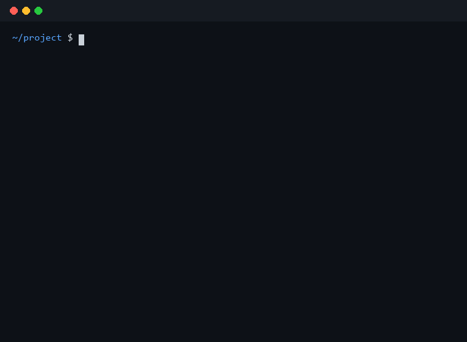

# Codigest

[](https://pypi.org/project/codigest/) [](https://github.com/NaNIsaac/codigest/actions/workflows/ci.yml) [](LICENSE)

<!-- mcp-name: io.github.NaNIsaac/codigest -->

**Share the code context you choose with an AI: your project, a few files, what changed, or the command that failed.**

**Documentation: [nanisaac.github.io/codigest](https://nanisaac.github.io/codigest/)** (installation, guides, command reference). [한국어](README.ko.md)

<p align="center">
  <a href="https://mcprush.com/to/codigest-mcp?ref=badge">
    
  </a>
  <br>
  <sub>Automated release-specific security scan (A–F), not an independent security certification.
  <a href="https://mcprush.com/trust">How ratings work</a>.</sub>
</p>

Codigest is a command-line tool for the moment you ask ChatGPT, Claude or a coding agent about
your code. It turns the part of your project you pick into one block of text you can paste into
any chat.

A model only knows what you show it. Copying files by hand is slow, it is easy to miss the one
file that matters, and it is just as easy to paste far more than the question needs. Codigest
lets you decide what to share and then collects it for you: the whole project, a file and the
files it imports, what changed since a point you marked, or a failing test with the code it points
at.

## What it does

- **Bundles code you pick.** The whole project, chosen files and folders, or the local files they
  import (Python, JS/TS), as one block with the file tree.
- **Shows what changed.** Text or function-level diffs since a baseline you set, without touching
  your Git history.
- **Brings in terminal output.** It records commands you run and can hand over a failing one
  together with the files its error points at.
- **Says what it included.** Every bundle reports its size, and `pack` gives the reason for each
  file and names the ones it left out.
- **Keeps secrets out.** `.env` files and keys are never included, and tokens in code or output
  are masked.
- **Works with agents.** Claude Code, Cursor and other MCP clients can request the same output.

Codigest does not call any AI model; it only prepares what you send to one. Everything runs on
your machine.

<p align="center">
  
  <br>
  <sub>One of the workflows below: a test fails, and one command collects what the model needs.</sub>
</p>

## Install

Prebuilt binary, no Python needed. Windows (PowerShell):

<!-- test windows -->
```powershell
irm https://raw.githubusercontent.com/NaNIsaac/codigest/main/install.ps1 | iex
```

Linux, macOS and Termux:

<!-- test unix -->
```bash
curl -fsSL https://raw.githubusercontent.com/NaNIsaac/codigest/main/install.sh | sh
```

This installs `cdg` to `%LOCALAPPDATA%\Programs\codigest` (added to your user `PATH`) on Windows,
`~/.local/bin` on Linux and macOS, and `$PREFIX/bin` in Termux. Run the same line again to update.
`CDG_VERSION=0.12.1` pins a version and `CDG_INSTALL_DIR=...` picks the folder (then `PATH` is left
alone). Supported: Windows x64, Linux x64 and ARM64, macOS Intel and Apple Silicon, Android ARM64
(Termux; the tests also run inside Termux in CI). Archives for download by hand are on the
[releases page](https://github.com/NaNIsaac/codigest/releases). No setup is needed in your projects.
Both scripts check the archive against the SHA-256 GitHub records for it. On Linux and macOS,
`install.sh` will not replace a `cdg` from the Python package in the same folder unless
`CDG_FORCE=1` is set.

### Python package

The same commands are on PyPI as `codigest`. Install it with [uv](https://docs.astral.sh/uv/), which
also fetches the Python version it needs (3.15) and keeps it apart from your projects:

```bash
winget install --id astral-sh.uv                  # Windows (skip if you have uv)
curl -LsSf https://astral.sh/uv/install.sh | sh   # macOS/Linux

uv tool install codigest
uv tool update-shell                              # then restart your terminal
```

The command is `codigest`, or `cdg` for short. Both installs provide a command called `cdg`, so keep
only one of them on `PATH`. If the install fails with a syntax error on `lazy import`, run
`uv self update` and try again.

Next, `cdg term install` hooks your shell so the output of every command is kept for `cdg pack` and
`cdg term`. It is off until you run it; see [Terminal capture](#terminal-capture).

On Windows, PowerShell's `help codigest` is a separate command from `codigest --help`.
For optional native `Get-Help` integration **without automatic command capture**:

```powershell
cdg shell-help install       # register comment-based PowerShell help
# open a new PowerShell window
help codigest               # or: Get-Help codigest
cdg shell-help uninstall     # remove it when no longer needed
```

This adds a small forwarding function to your PowerShell profile; other `help` commands are
unchanged. The CLI's own full command reference is still available via `cdg --help`.

In a terminal, every command below copies its result to the clipboard. Add `-s` to also print it,
`-o FILE` to also write it to a file, `--no-copy` to leave the clipboard alone, and `-m "..."` to
put your question or instruction in it. When the output goes to a pipe or a file instead
(`cdg scan > ctx.xml`, `cdg digest | less`, a script, a coding agent's shell), it is printed and
the clipboard is left alone; add `--copy` to copy it anyway. Over SSH the copy goes to the clipboard of the machine you
type on (OSC 52), not the remote one; see [output options](https://nanisaac.github.io/codigest/commands#output-options).

## 1. Share your project with an AI chat

Run `scan` in your project and paste:

```bash
cdg scan
```

```console
$ cdg scan
Copied snapshot to clipboard
Snapshot 3 files, ~121 tokens
```

The clipboard now holds the file tree and every file, honoring `.gitignore`:

```xml
<project_snapshot project="project">
<project_structure>
├── .gitignore
├── prices.py
└── test_prices.py
</project_structure>
<source_code>
<file path=".gitignore">
.venv/
__pycache__/
.pytest_cache/
</file>

<file path="prices.py">
def apply_discount(price, percent):
    return price * (1 - percent)
</file>

<file path="test_prices.py">
from prices import apply_discount


def test_ten_percent():
    assert apply_discount(200, 10) == 180
</file>
</source_code>
</project_snapshot>
```

Large projects ask before copying (above 30k tokens or 100 files). For those, share less, as in
the next section.

## 2. Share only part of it, or what changed

```bash
cdg scan src/app.py -r       # one file and the local files it imports, recursively
cdg scan src/billing/ docs/  # folders, files, or both
cdg scan src/app.py -l       # with line numbers, so answers can say "line 42"
cdg scan src/app.py:40-80    # only lines 40 to 80, numbered (src/app.py:42 for one line)
cdg digest                   # signatures and docstrings only, much smaller
cdg digest src/billing/      # the same for one folder
cdg tree -L 2                # the file tree, two levels deep
```

The examples from here on are the same project a little later: `prices.py` has grown a `Cart`
class, and an old MATLAB version sits in `legacy/`.

`digest` is the overview to start a conversation with. It lists every function, class and
top-level variable of Python files, and the functions and `%%` sections of MATLAB files, in the
order they appear, with the line they start on and the first line of their docstring (or, in
MATLAB, of their help comment). Class attributes and dataclass fields are listed with their
values, shortened when long:

```console
$ cdg digest -s
<code_digest project="project" contents="signatures and docstrings, no bodies">
<project_structure>
├── .gitignore
├── legacy
│   └── discount.m
├── prices.py
└── test_prices.py
</project_structure>
<file path="legacy/discount.m">
1: function p = discount(price, percent)
       Price after taking off percent percent.
3: %% Apply
</file>
<file path="prices.py">
 1: TAX_RATE = 0.1
 4: def apply_discount(price: float, percent: float) -> float
        Price after taking off `percent` percent.
 9: class Cart
        Items and the discount that applies to all of them.
12:   def __init__(self, percent: float=0)
16:   def total(self) -> float
          Sum after discount and tax.
</file>
<file path="test_prices.py">
4: def test_ten_percent()
</file>
</code_digest>
Digest 3 files, ~192 tokens
```

A model that has seen this can ask for exactly what it needs ("show me `Cart.total`"), and
`cdg scan prices.py:16-19` gives it just that method, numbered the same way:

```console
$ cdg scan prices.py:16-19 -s
<project_snapshot project="project">
<project_structure>
└── prices.py
</project_structure>
<source_code>
<file path="prices.py" lines="16-19">
16:     def total(self) -> float:
17:         """Sum after discount and tax."""
18:         subtotal = sum(apply_discount(p, self.percent) for p in self.items)
19:         return subtotal * (1 + TAX_RATE)
</file>
</source_code>
</project_snapshot>
```

`tree -L` keeps a large or vendored folder from flooding the output:

```console
$ cdg tree -L 1
├── .gitignore
├── legacy/ (1 file)
├── prices.py
└── test_prices.py
```

To share what changed while you work, set a baseline first:

```bash
cdg mark                     # e.g. before a refactor
# ... work ...
cdg diff                     # text diff since the mark
cdg semdiff                  # Python: which functions and classes changed
```

A baseline is a private copy kept in `.codigest/`; your Git history is not touched.

## 3. Hand over a failing command

Run the command through `cdg cap`. The output looks exactly as it would without it; Codigest
keeps a copy. Then ask for a pack:

```bash
cdg cap -- pytest -q        # or npm test, cargo test, go test ./..., make
cdg pack
```

```console
$ cdg pack
Packed ~370 / 30,000 tokens
  failed   pytest -q (exit 1, just now)
  changes  uncommitted changes (git)
  + test_prices.py  line 5 in failing output
  + prices.py       changed
Copied pack to clipboard
```

Read it as: the failing command, your uncommitted Git changes, `test_prices.py` because the error
points at its line 5, and `prices.py` because you edited it.

<details>
<summary>What exactly was copied</summary>

```xml
<context_pack project="project">
<terminal_history>
<command index="1" command="pytest -q" exit_code="1" cwd="~/project" duration="1.5s" at="2026-10-17T01:58:14+09:00">
<output>
F                                                                      [100%]
================================= FAILURES ==================================
_____________________________ test_ten_percent ______________________________

    def test_ten_percent():
>       assert apply_discount(200, 10) == 180
E       assert -1800 == 180
E        +  where -1800 = apply_discount(200, 10)

test_prices.py:5: AssertionError
========================== short test summary info ==========================
FAILED test_prices.py::test_ten_percent - assert -1800 == 180
1 failed in 0.11s
</output>
</command>
</terminal_history>
<changes source="uncommitted changes (git)">
diff --git a/prices.py b/prices.py
index 3d691df..428752a 100644
--- a/prices.py
+++ b/prices.py
@@ -1,2 +1,2 @@
 def apply_discount(price, percent):
-    return price * (1 - percent / 100)
+    return price * (1 - percent)
</changes>
<file path="test_prices.py" reason="line 5 in failing output">
1: from prices import apply_discount
2: 
3: 
4: def test_ten_percent():
5:     assert apply_discount(200, 10) == 180
</file>
<file path="prices.py" reason="changed">
1: def apply_discount(price, percent):
2:     return price * (1 - percent)
</file>
</context_pack>
```

Files that did not fit the budget would be listed in an `<omitted>` block, so the model knows
what it is not seeing.

</details>

### How `pack` decides

Plain `cdg pack` fills its token budget (default 30,000) in this order:

1. Files named in the output of the last failed command run in this project in the past hour:
   `File "x.py", line 7` (Python), `x.py:7` (pytest, ruff, gcc, rustc, eslint), `x.ts(7,3)` (tsc).
   Once the same command passes again, that failure is no longer used. A file that is only named
   in the output, not changed by you, comes as an excerpt: ten lines around each place the output
   points at, marked with a `lines="40-60"` attribute. Short files come whole.
2. The project functions and classes that the failing Python tests call, whole, with reason
   `called from failing test ...`. A traceback that ends in an assertion names only the test; this
   brings the code under test even when the bug is already committed and nothing shows in a diff.
3. Files you changed: uncommitted and untracked files in Git, or changes since `cdg mark`. A long
   changed file comes as the parts its diff hunks touch (the diff itself is in the pack already).
4. Tests that import those files (`test_*.py`, `*_test.py`, `*.test.ts`, `*.spec.js`, ...).
5. Project files they import: Python imports, and relative imports in JS/TS (`./x`, `./x.js` for
   `x.ts`, `./dir` for `dir/index.ts`).

When you name files, you get only those files. `--with` adds automatic sources back:

```bash
cdg pack src/prices.py                         # just this file
cdg pack src/prices.py --with tests            # this file and its tests
cdg pack --with changes                        # only your changes, no failure
cdg pack --with failure,changes,tests,imports  # the same as plain `cdg pack`
```

The failed command and the diff are always included when their source is on. A long command
output keeps its first 80 and last 40 lines (the first failures and the summary); `cdg term -f`
shows all of it. Tokens are estimated
at four characters each, so the budget is approximate.

### Making it smoother

`cdg term install` hooks your shell so every command is captured without typing `cdg cap`
(`cdg term uninstall` removes it). `cdg term` shows what was captured; see
[Terminal capture](#terminal-capture).

## 4. Let an agent fetch it

Connect your coding agent over MCP and it requests context itself instead of asking you to paste:

```bash
claude mcp add --scope user codigest -- cdg mcp      # Claude Code
```

Other clients (Cursor, VS Code, Claude Desktop): add a stdio server with command `cdg` and args
`["mcp"]`. The tools are listed under [MCP tools](#mcp-tools).

An agent that can run shell commands needs no setup at all. Its shell is not a terminal, so `cdg`
prints the result for it and never touches your clipboard. A way of working that suits agents:

```bash
cdg tree -L 2                      # where things are
cdg digest src/                    # what is defined where, with line numbers
cdg scan src/prices.py:16-19      # read the parts that matter, numbered the same way
cdg mark                           # before editing
cdg semdiff                        # afterwards: which functions it changed
cdg cap -- pytest -q && cdg pack   # run the tests; on failure, the pack has what to fix
```

The code in every block is exactly as written in the file (`->`, `<`, `&` are not escaped), so
code copied out of it can be pasted back. A large `scan` with nobody to answer the size question
stops with a hint instead of waiting; `-y` takes it all.

## Reference

- [All commands](#all-commands)
- [Terminal capture](#terminal-capture)
- [MCP tools](#mcp-tools)
- [Configuration](#configuration)
- [Privacy and safety](#privacy-and-safety)
- [Upgrading from 0.9](#upgrading-from-09)
- [How it works](#how-it-works)
- [Development](#development)

### All commands

`cdg --help` lists them in the same groups.

| Command | What it gives you | Writes to your project |
| --- | --- | --- |
| `scan` | The whole project, or chosen paths, as one block | nothing |
| `digest` | Numbered signatures and docstrings, no bodies (Python, MATLAB) | nothing |
| `tree` | Project tree (`-L N` limits the depth) | nothing |
| `mark` | Sets the baseline | `.codigest/` |
| `diff` | Text diff since the baseline | nothing |
| `semdiff` | Function and class level changes since the baseline (Python) | nothing |
| `cap` | Runs a command and keeps its output | nothing |
| `term` | Recent captured commands with output | nothing |
| `pack` | Last failure, the files it names, your changes | nothing |
| `mcp` | MCP server for agents | nothing |
| `status` | What `pack` would use here: last failure, changes, baseline | nothing |
| `init` | `.codigest/config.toml` for [file filters](#configuration) | `.codigest/`, `.gitignore` |
| `clean` | Deletes `.codigest/` (asks first, `-y` to skip) | removes `.codigest/` |

Shared options: `-s` / `--stdout` also prints the result (status messages go to stderr; on by
default when piped), `--copy` / `--no-copy` overrides the clipboard default (copy in a terminal,
not when piped), `-o FILE` also writes it to a file, `-m` / `--message` adds an
instruction.
`scan -l` adds line numbers, `scan -a` ignores the config filters, `scan -y` skips the
confirmation (CI). `-r` / `--resolve` on `scan`, `diff`, `semdiff` and `digest` also pulls in
local files imported by the targets. `scan` and `term` take `--format markdown|json` for chats that
render Markdown or for scripts (XML is the default). `--preset NAME` on any command fills in options
saved under `[presets.<command>.NAME]` in `.codigest/config.toml` or your user config; options typed
after it win. `cdg <command> --help` lists everything.

### Terminal capture

`cdg cap` streams the command's output live and records the command line, combined
stdout/stderr, exit code and working directory. `cdg term --context` also includes the
hostname at capture time and the shell name. The PC name is opt-in because it may be
sensitive; older captures have no hostname, and `cdg term` still copies without it.
Captures from all projects share one store on
your machine, so `cap` and `term` work in any directory.

```bash
cdg cap "npm run build | tail -20"  # quote pipelines
cdg term              # last command and its output
cdg term -n 3         # last 3
cdg term -f           # last failed one
cdg term --context   # add the PC hostname and shell to the copied context (opt-in)
cdg term --here -n 3  # last 3 run in this project
cdg term -i 2         # only the command from 2 runs ago
cdg term -n 3 --format json  # the last 3 as JSON (markdown also works)
cdg term path         # where captures are stored (override with CODIGEST_HOME)
cdg term clear        # delete all captures
```

Commands not run through `cap` are read from the native shell history (PowerShell, bash, zsh,
fish), without their output.

#### Automatic capture

`cdg term install` edits your PowerShell profile, `~/.bashrc` and `~/.zshrc` for whichever of
these shells is installed; choose with `--shell powershell|bash|zsh|all`. On Windows, Git Bash
counts as bash. Commands still run in your current session (`cd`, variables and functions work
normally) and appear in your history as typed. Programs that need a real terminal are skipped: editors, pagers, `ssh`, full-screen tools (`tmux`, `zellij`, `herdr`, `k9s`, `yazi`, ...), `docker`/`podman`/`kubectl` with `-it`, `npm`/`pnpm`/`yarn`/`bun` `init` or `create`, `npx create-*`, `pip uninstall`, `gh auth login`, `az login`, `gcloud auth login` and `gcloud init`, `aws configure`, `ssh-keygen`, `sudo`, and database shells (`psql`, `mysql`, `sqlite3`, ...). A prompt that does not end its line stays invisible in the capture pipe until the next newline, so the command would look stuck.

- Skip one command: start the line with a space.
- Skip more programs: `$env:CODIGEST_CAP_SKIP = '^\s*(myrepl|mytui)\b'` (bash/zsh:
  `export CODIGEST_CAP_SKIP='^(myrepl|mytui)( |$)'`, an extended regex).
- Disable for a session: `$env:CODIGEST_NOCAP = 1` (bash/zsh: `export CODIGEST_NOCAP=1`).
- Remove the hooks: `cdg term uninstall`. Each startup file gets back the exact bytes it had
  before install (line endings, BOM, final newline); one that install created is deleted with
  any folder made for it, as are the hook copies in the data folder. Captured commands stay
  until `cdg term clear`.

The profile loads a copy of the hook that `cdg term install` puts in the data folder (`shell/` next to the captures), not the file inside the package. After updating codigest, run `cdg term install` again to refresh it.

Limitations:

- Captured programs write to a pipe, not a TTY, so some lose colors or progress bars.
- In bash (4+) and zsh, multi-line commands (loops typed over several lines, heredocs),
  background jobs (`cmd &`) and lines using `!` history expansion are not captured; they run
  normally. In bash, neither are lines that start with a subshell `( ... )`.
- In bash the hook uses the DEBUG trap and keeps one set before the first prompt (starship,
  bash-preexec); a DEBUG trap set later replaces it.
- Long output is bounded: the PowerShell hook keeps the first and last 2,000 lines, and a bash or
  zsh capture file over 4 MB is read 1 MB from each end. The store then keeps 64 KB.
- In PowerShell, a command counts as failed when its exit code is non-zero or an error reached
  the screen; an error hidden with `-ErrorAction` is not a failure.
- The PowerShell hook does not wrap lines in remote sessions, nested prompts or the debugger.

### MCP tools

| Tool | Returns |
| --- | --- |
| `pack` | Last failure, the files it names, changes and their imports, cut to a budget (`targets`, `with`, `budget`, `message`) |
| `terminal_history` | Recent commands with output and exit code (`count`, `failed`, `here`: only this project, default on) |
| `scan` | Project snapshot (`targets`, `resolve`, `message`) |
| `diff` / `semdiff` | Text / structural changes since the baseline |
| `digest` | Signatures and docstrings only |
| `tree` | Directory tree |

The tools return the same text the CLI prints. None of them moves the baseline, and paths
outside the project the server was started in are refused.

### Configuration

`cdg init` writes `.codigest/config.toml`. The `[filter]` section controls which files every
command considers:

```toml
[filter]
# Only these extensions (omit to include every non-ignored file)
extensions = [".py", ".ts", ".rs", ".md", ".json"]

# Extra exclusions, in .gitignore syntax (.gitignore itself is always honored)
exclude_patterns = [
    "*.lock",
    "tests/data/",
    "legacy_code/"
]
```

`.git/`, `.codigest/`, virtual environments, `node_modules/` and `__pycache__/` are always
skipped.

### Privacy and safety

- **Credential files.** `.env*` (except `.env.example` and similar templates), `*.pem`, `*.key`,
  `*.p12`, `*.pfx`, keystores, `.netrc`, `.pgpass` and SSH private keys are never included by any
  command. `scan` says which it withheld, `pack` lists them as omitted, and their hunks in a diff
  are replaced with a notice.
- **Tokens in code and diffs.** Private keys, JWTs, vendor tokens (OpenAI, GitHub, AWS, Google,
  Slack, GitLab, npm, Stripe `sk_`/`rk_`, Hugging Face `hf_`) and passwords in URLs are masked in everything Codigest outputs. Ordinary
  code such as `token = get_token()` is left alone.
- **Secrets in captures.** On top of that, terminal output is checked before it is written to
  disk for `Authorization` headers and for `key=value` and `key: value` pairs, with a quoted key
  (`"password": "..."`) or a key that ends in a secret name after `_` or `-`
  (`AWS_SECRET_ACCESS_KEY`, `DB_PASS`; also `pass` and `pwd`). The output of credential-printing
  commands is never stored: `env`, `printenv`, `gh auth token`, `aws configure` and
  `aws sts get-session-token`/`assume-role`, `az account get-access-token`,
  `gcloud auth print-access-token`, `kubectl get secret`, `kubectl config view --raw`,
  `op read`, `bw get`, `pass show`, `vault read`, `cat` of `.env`, `.npmrc`, `.pypirc`, `.netrc`, key
  files or `credentials.json`, and a few more (the full list is `DENY_COMMANDS` in
  `src/codigest/core/redact.py`).
- These rules catch common formats, not every possible secret.
- **Your project.** No command changes your source files. Only `mark` and `init` create
  `.codigest/`, which holds its own `.gitignore` (`*`) so it never shows in `git status`; `init`
  also adds it to the project's `.gitignore`.
- **Where captures live.** `cdg term path` shows the file. On macOS and Linux it is readable only
  by you. `cdg term clear` deletes it.
- **Nothing leaves your machine.** Codigest makes no network requests. Context goes where you
  paste it, or to the MCP client you connected.

### Upgrading from 0.9

- Piped or redirected output is printed without `-s` and no longer copied; add `--copy` if a
  script relied on the clipboard.
- `<file>` blocks hold the code verbatim instead of XML-escaped. A custom template in
  `.codigest/prompts.toml` now receives the blocks unescaped too; only `{instruction}` is escaped.
- `digest` output is numbered, in source order, with docstrings, and takes several paths.

### Upgrading from 0.8

- `scan`, `diff`, `semdiff` and `digest` no longer save into `.codigest/*.txt`; use `-o FILE`.
  `diff --no-save` and the like are gone.
- `cdg init` no longer sets a baseline; run `cdg mark`.
- `cdg pack FILES` packs only those files; add `--with failure,changes,tests,imports` for the
  previous behavior.
- Outputs no longer start with built-in instructions to the model ("You are an expert..."). Put
  your own with `-m`, or a template in `.codigest/prompts.toml`.

### How it works

- **Baseline.** A Git repository at `.codigest/anchor/.shadow_git`, separate from your project's
  repository. `mark`
  commits the current state to it; `diff`, `semdiff`, `status` and `pack` compare the working tree
  against it.
- **Captures.** One newline-delimited JSON file holds the last 200 commands; each output is capped
  at 64 KB, keeping the head and tail.
- **Output.** File contents go into `<file>` blocks verbatim. Only a closing tag of one of
  Codigest's own blocks inside a file (a literal `</file>`) is written as `&lt;/file>`, so it
  cannot end the block early.
- **MCP.** The server is a small JSON-RPC loop over stdio. Each tool runs the regular CLI with
  `-s --no-copy`, so an agent sees exactly what you would paste.

### Development

```bash
git clone https://github.com/NaNIsaac/codigest
cd codigest
uv run cdg --help              # run from the checkout
uv run --with pytest pytest -q # tests
```

## License

MIT. See [LICENSE](LICENSE).
